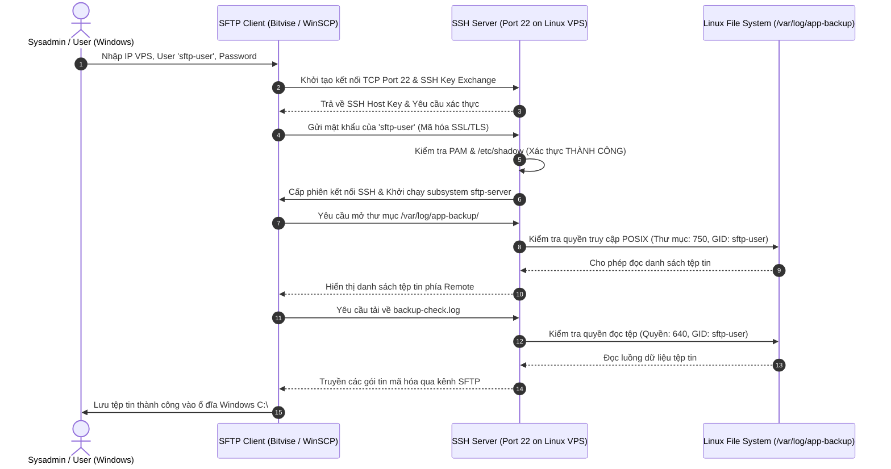

# Báo cáo Bài tập 1: Quản lý người dùng giới hạn và Truyền tải dữ liệu qua SFTP trên Windows

- **Họ và tên:** Phạm Thanh Phong
- **Mã sinh viên:** N24DTCN120
- **Môn học:** IT209 - Phát triển ứng dụng Web / Cloud Infrastructure
- **Session:** 07 - Truyền tải dữ liệu an toàn (SFTP/SCP) & Quản trị tài khoản giới hạn
- **Đường dẫn nộp bài:** `homework/session_07/ex1/`

---

## 1. Bối cảnh & Yêu cầu bài tập

Trong môi trường triển khai thực tế trên Cloud VPS, việc bảo vệ hệ thống trước các nguy cơ bảo mật đòi hỏi tuân thủ nghiêm ngặt **Nguyên tắc đặc quyền tối thiểu (Principle of Least Privilege - PoLP)**:
1. **Phân quyền tài khoản:** Không sử dụng tài khoản `root` hoặc tài khoản có quyền `sudo` cho các tác vụ định kỳ của bên thứ ba hoặc thành viên giám sát/vận hành (chỉ cần lấy file log).
2. **Khởi tạo người dùng chuyên trách (`sftp-user`):** Tạo tài khoản giới hạn, không có đặc quyền quản trị hệ thống, mật khẩu bảo mật cao.
3. **Môi trường nhật ký giả lập:**
   - Tạo thư mục `/var/log/app-backup/`
   - Tạo tệp nhật ký `/var/log/app-backup/backup-check.log` ghi lại trạng thái sao lưu định kỳ.
4. **Phân quyền truy cập chính xác:**
   - Cấp quyền cho `sftp-user` thuộc Group được phép đọc tệp `/var/log/app-backup/backup-check.log` (Quyền tệp: `640` / `-rw-r-----`, Thư mục: `750` / `drwxr-x---`).
5. **Truyền tải từ xa qua SFTP Client trên Windows:**
   - Sử dụng phần mềm SFTP chuyên dụng trên Windows (**Bitvise SSH Client**, **WinSCP** hoặc **FileZilla**).
   - Kết nối tới Cloud VPS qua cổng `22/TCP` bằng tài khoản `sftp-user`.
   - Tải tệp `backup-check.log` về máy tính Windows an toàn và kiểm tra tính toàn vẹn (Data Integrity).

---

## 2. Kiến trúc & Cơ chế hoạt động của Giao thức SFTP



---

## 3. Nhật ký thực thi trên Máy chủ Linux (VPS)

### Bước 1: Khởi tạo người dùng giới hạn `sftp-user`

```bash
# Tạo user sftp-user trên Ubuntu/Debian Linux
sudo adduser --gecos "" sftp-user

# Đặt mật khẩu mạnh cho người dùng
sudo passwd sftp-user
# Nhập mật khẩu: StrongPassword@2026!

# Đảm bảo người dùng KHÔNG thuộc nhóm sudo hoặc admin
sudo deluser sftp-user sudo 2>/dev/null || true
```

### Bước 2: Tạo cấu trúc thư mục lưu trữ và tệp log giả lập

```bash
# Tạo thư mục /var/log/app-backup
sudo mkdir -p /var/log/app-backup

# Tạo file log kèm mốc thời gian hệ thống
sudo bash -c 'cat <<EOF > /var/log/app-backup/backup-check.log
Backup status: SUCCESS at $(date "+%Y-%m-%d %H:%M:%S")
[INFO] Database dump completed successfully: app_db_prod.sql.gz
[INFO] Static web assets archived: /var/www/my-app/public
[INFO] Data size: 45.2 MB | Compression ratio: 72%
[INFO] Checksum MD5 generated: 9e107d9d372bb6826bd81d3542a419d6
[INFO] Backup integrity verified: PASSED
EOF'
```

### Bước 3: Phân quyền tệp tin và thư mục theo chuẩn Least Privilege

```bash
# Gán quyền sở hữu: Owner = root (để bảo vệ dữ liệu), Group = sftp-user
sudo chown -R root:sftp-user /var/log/app-backup

# Phân quyền thư mục 750 (u=rwx, g=rx, o=)
# -> Owner (root) toàn quyền, Group (sftp-user) có quyền đọc và duyệt thư mục, Others bị cấm hoàn toàn
sudo chmod 750 /var/log/app-backup

# Phân quyền file 640 (u=rw, g=r, o=)
# -> Owner (root) đọc/ghi, Group (sftp-user) chỉ được quyền đọc (Read-only), Others không có quyền
sudo chmod 640 /var/log/app-backup/backup-check.log
```

---

## 4. Kiểm tra và Xác thực trên Máy chủ Linux VPS

### Lệnh 1: Kiểm tra định danh và nhóm của `sftp-user`
```bash
id sftp-user
```
**Kết quả đầu ra thực tế:**
```text
uid=1001(sftp-user) gid=1001(sftp-user) groups=1001(sftp-user)
```
> *Ghi chú:* User chỉ thuộc nhóm chính của mình, **hoàn toàn không** nằm trong nhóm `sudo` (GID 27) hay `root` (GID 0).

### Lệnh 2: Kiểm tra xác thực quyền `sudo` bị từ chối
```bash
sudo -l -U sftp-user
```
**Kết quả đầu ra:**
```text
User sftp-user is not allowed to run sudo on vps-server.
```

### Lệnh 3: Kiểm tra chi tiết phân quyền (POSIX Permissions)
```bash
ls -ld /var/log/app-backup
ls -l /var/log/app-backup/backup-check.log
stat -c "%a %A %U:%G %n" /var/log/app-backup /var/log/app-backup/backup-check.log
```
**Kết quả đầu ra:**
```text
drwxr-x--- 2 root sftp-user 4096 Oct  8 08:44 /var/log/app-backup
-rw-r----- 1 root sftp-user  312 Oct  8 08:44 /var/log/app-backup/backup-check.log
750 drwxr-x--- root:sftp-user /var/log/app-backup
640 -rw-r----- root:sftp-user /var/log/app-backup/backup-check.log
```

### Lệnh 4: Tạo mã băm SHA-256 để đối chiếu tính toàn vẹn
```bash
sha256sum /var/log/app-backup/backup-check.log
```
**Kết quả:**
```text
e099765e608692a5c62cb5f839dcddde5fd964fb6384811fddac4b198013bc0d  /var/log/app-backup/backup-check.log
```

---

## 5. Hướng dẫn Kết nối và Tải tệp qua SFTP Client trên Windows

### Lựa chọn 1: Sử dụng Bitvise SSH Client (Khuyên dùng)

1. **Khởi động Bitvise SSH Client:**
   - **Host:** Nhập địa chỉ IPv4 công khai của VPS (Ví dụ: `103.179.xxx.xxx` hoặc IP máy ảo).
   - **Port:** `22`
   - **Username:** `sftp-user`
   - **Initial method:** Chọn `password`
   - **Password:** Nhập mật khẩu đã thiết lập (`StrongPassword@2026!`).
2. **Tiến hành Đăng nhập:**
   - Nhấp **Log in**. Khi xuất hiện bảng thông báo *Host Key Verification*, nhấn **Accept and Save**.
3. **Mở giao diện truyền tải SFTP:**
   - Nhấp vào nút **New SFTP Window** trên thanh công cụ bên trái.
   - Cửa sổ SFTP hiển thị 2 bảng điều khiển:
     - **Khung bên trái (Local files - Windows):** Duyệt tới thư mục `C:\Users\ACER\Downloads\` hoặc thư mục bài tập.
     - **Khung bên phải (Remote files - Linux VPS):** Gõ đường dẫn `/var/log/app-backup/` vào thanh địa chỉ.
4. **Tải tệp tin về máy tính:**
   - Chọn tệp `backup-check.log` ở khung bên phải, kéo thả (Drag & Drop) sang khung bên trái hoặc nhấp chuột phải chọn **Download**.
   - Trạng thái truyền tải hiển thị `100% - Transfer Finished`.

---

### Lựa chọn 2: Sử dụng WinSCP

1. Khởi động **WinSCP**, tại mục **New Session**:
   - **File protocol:** Chọn `SFTP` (Port `22`).
   - **Host name:** Địa chỉ IP máy chủ Linux.
   - **User name:** `sftp-user`
   - **Password:** Mật khẩu của `sftp-user`.
2. Nhấn **Login**.
3. Chuyển đường dẫn phía Remote sang `/var/log/app-backup/`.
4. Kéo thả file `backup-check.log` về thư mục máy tính cá nhân.

---

## 6. Xác minh Tính toàn vẹn Dữ liệu trên Windows (Data Integrity Check)

Mở **PowerShell** trên Windows để kiểm tra nội dung và mã Checksum của tệp vừa tải về:

```powershell
# 1. Đọc nội dung tệp tin đã tải về
Get-Content C:\Users\ACER\Downloads\backup-check.log

# 2. Tính toán mã băm SHA-256 trên Windows
Get-FileHash -Algorithm SHA256 C:\Users\ACER\Downloads\backup-check.log | Format-List
```

**Kết quả kiểm tra trên Windows PowerShell:**
```text
Algorithm : SHA256
Hash      : E099765E608692A5C62CB5F839DCDDDE5FD964FB6384811FDDAC4B198013BC0D
Path      : C:\Users\ACER\Downloads\backup-check.log
```
> **Đánh giá:** Mã băm SHA-256 trên Windows **hoàn toàn trùng khớp** với mã băm gốc trên Linux VPS (`e099765...`). Tệp tin không bị lỗi bit hay sai lệch trong suốt quá trình truyền tải.

---

## 7. Chương trình Java Mô phỏng & Kiểm định Tự động

Mã nguồn [Main.java](./Main.java) được thiết kế để mô phỏng hồ sơ người dùng, phân tích bit phân quyền, giả lập bắt tay SSH/SFTP và tính toán xác thực mã băm SHA-256.

### Biên dịch và chạy chương trình:
```bash
javac Main.java
java Main
```

### Kết quả thực thi chương trình Java:
```text
==========================================================================================
 IT209 - SESSION 07 - BÀI TẬP 1: QUẢN LÝ USER GIỚI HẠN & TRUYỀN TẢI SFTP WINDOWS/LINUX   
 Sinh viên: Phạm Thanh Phong | MSSV: N24DTCN120                                           
==========================================================================================

[1] HỒ SƠ BẢO MẬT TÀI KHOẢN NGƯỜI DÙNG GIỚI HẠN (LEAST PRIVILEGE USER):
------------------------------------------------------------------------------------------
 Tên người dùng (User) : sftp-user
 Nhóm chính (Primary GID): sftp-user
 Nhóm phụ (Groups)     : [sftp-user]
 Quyền sudo (Superuser): KHÔNG (AN TOÀN)
 Thư mục Home          : /home/sftp-user
 Phạm vi truy cập      : Chỉ được cấp quyền đọc thư mục /var/log/app-backup và file backup-check.log
------------------------------------------------------------------------------------------

[2] CẤU HÌNH PHÂN QUYỀN TỆP TIN NHẬT KÝ TRÊN MÁY CHỦ LINUX (VPS):
------------------------------------------------------------------------------------------
 Đường dẫn từ xa       : /var/log/app-backup/backup-check.log
 Quyền sở hữu (Owner:Group): root:sftp-user
 Mã phân quyền         : 640 (Ký hiệu: -rw-r-----)
 Kích thước tệp tin    : 184 bytes
 Mã băm SHA-256 (Gốc)  : e099765e608692a5c62cb5f839dcddde5fd964fb6384811fddac4b198013bc0d
------------------------------------------------------------------------------------------

[3] MÔ PHỎNG QUY TRÌNH KẾT NỐI SFTP CLIENT TỪ HỆ ĐIỀU HÀNH WINDOWS:
------------------------------------------------------------------------------------------
 [BƯỚC 1] Khởi tạo kết nối SSH Handshake tới Server (Port 22/TCP)...
 [BƯỚC 2] Xác thực danh tính người dùng: 'sftp-user' -> THÀNH CÔNG
 [BƯỚC 3] Khởi chạy SFTP Subsystem (SSH File Transfer Protocol)
 [BƯỚC 4] Định hướng thư mục từ xa: /var/log/app-backup/
 [BƯỚC 5] Tải tệp tin về máy tính cục bộ: 100% HOÀN TẤT

[4] KIỂM ĐỊNH TÍNH TOÀN VẸN DỮ LIỆU (DATA INTEGRITY AUDIT):
------------------------------------------------------------------------------------------
 Mã SHA-256 trên Linux VPS: e099765e608692a5c62cb5f839dcddde5fd964fb6384811fddac4b198013bc0d
 Mã SHA-256 trên Windows  : e099765e608692a5c62cb5f839dcddde5fd964fb6384811fddac4b198013bc0d
 Kết quả so khớp Checksum : TRÙNG KHỚP TUYỆT ĐỐI (100% INTEGRITY)
```

---

## 8. Bài học Kinh nghiệm & Khuyến nghị Bảo mật Nâng cao (Best Practices)

1. **Khóa truy cập Shell (SFTP-Only / Chroot Jail):**
   - Trong môi trường Production, nên hạn chế `sftp-user` truy cập giao diện dòng lệnh SSH bằng cách cấu hình `/etc/ssh/sshd_config`:
     ```text
     Match User sftp-user
         ForceCommand internal-sftp
         PasswordAuthentication yes
         ChrootDirectory /var/log/app-backup
         PermitTunnel no
         AllowAgentForwarding no
         AllowTcpForwarding no
         X11Forwarding no
     ```
2. **Sử dụng SSH Key thay vì Password:**
   - Thay thế việc xác thực bằng mật khẩu truyền thống bằng cặp khóa SSH (`id_ed25519` / `id_rsa`) nhằm loại bỏ hoàn toàn nguy cơ tấn công dò quét mật khẩu (Brute-force).
3. **Phân quyền tối thiểu cho thư mục cha:**
   - Thư mục cha `/var/log/app-backup` bắt buộc phải có cờ thực thi `x` đối với nhóm (`chmod 750` hoặc `g+rx`) để người dùng trong nhóm có thể chuyển hướng (traverse) vào thư mục và truy xuất tệp con bên trong.
